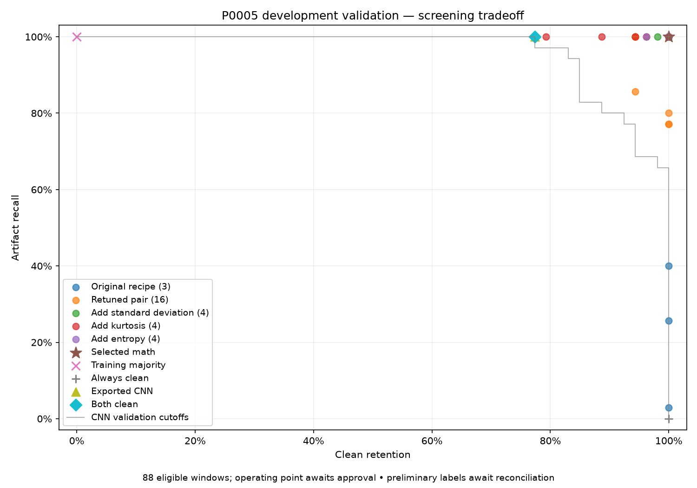

# Mathematical detector recommendation for Zach

Status: **proposal; approval and final freeze pending**. The saved artifact is
[`proposed-math-method.json`](proposed-math-method.json). No reserved repeat
recordings or labels were inspected for this recommendation.

The [assignment coverage checklist](thanksgiving-assignment-checklist.md) maps
all five parts to their evidence and identifies approval-dependent work.

## Recommended rule

Keep the existing, unfiltered two-second windows at 256 Hz, with 512 samples
per channel in the order TP9, AF7, AF8, TP10. Flag a window as artifact when
**any** channel satisfies either condition:

- Peak-to-peak amplitude **>123.63281250000001 µV**.
- Maximum absolute adjacent-sample jump **>52.24609375 µV**.

Equality passes. All eight required values must be available and finite.
The prediction retains the window ID, exact settings, and every triggering
channel, feature, value, inequality, and threshold. IDs and times stay outside
numeric features. Missing inputs never imply clean.

Continue calculating all six existing features separately for every channel.
Keep their definitions fixed: population standard deviation, Pearson kurtosis,
flatline tolerance 0.1 µV, and approximate entropy with m=2, natural logarithms,
self-matches, and inclusive tolerance 0.2 times the channel's population
standard deviation. The saved definition and source hashes identify the full
implementation. No filtering, new feature, or recording-protocol change is
part of this proposal.

## Selection evidence

Derive limits from the 205 labeled clean windows in the approved November 8
recordings. The independent 80/90/95/99 percentile pairs give 16 base candidates.
P0005 validation selects the 80th-percentile peak-to-peak and 90th-percentile
jump limits. The objective is the mean of artifact recall and clean retention,
with ties favoring recall and then clean retention.

The bounded comparison tested 31 policies, including the original recipe and
standard deviation, kurtosis, and entropy extensions. An extension needed a
strict improvement over its preceding policy. Standard deviation and entropy
added no benefit at their best settings. Kurtosis rejected two extra clean
windows. Leave these additions out of the recommended detector.

Training analysis supported high kurtosis and low entropy as candidate
directions; it did not assume that every artifact has high entropy or kurtosis.
See [the rule comparison](additional-mathematical-rules.md) for hypotheses,
candidate limits, direction evidence, and all variant results.

## Preliminary P0005 comparison

The same 88 eligible IDs contain 35 artifact and 53 clean windows. Exclude
20 uncertain and three loader-invalid windows separately.

| Policy | TP / FP / TN / FN | Artifact recall | Precision | Clean retention | Accepted contamination | Coverage |
| --- | --- | --- | --- | --- | --- | --- |
| Selected math | 35 / 0 / 53 / 0 | 35/35 | 35/35 | 53/53 | 0/53 | 53/88 |
| CNN, score >=0.5 | 35 / 12 / 41 / 0 | 35/35 | 35/47 | 41/53 | 0/41 | 41/88 |
| Accept only when both say clean | 35 / 12 / 41 / 0 | 35/35 | 35/47 | 41/53 | 0/41 | 41/88 |
| Training-majority reference | 35 / 53 / 0 / 0 | 35/35 | 35/88 | 0/53 | unavailable, 0/0 | 0/88 |
| Always clean | 0 / 0 / 53 / 35 | 0/35 | unavailable, 0/0 | 53/53 | 35/88 | 88/88 |

At equal validation acceptance of 53/88, the CNN cutoff is
0.692649245262146. CNN recall is 29/35, clean retention 47/53, and accepted
contamination 6/53. Combining it with math gives recall 35/35, clean retention
47/53, contamination 0/47, and coverage 47/88. The coverage difference between
the two single detectors is zero. This alternate cutoff is a validation
comparison, not the proposed primary CNN cutoff.

The agreement policy offers no improvement over math on this participant and
rejects more clean windows. Report that result directly. Perfect validation
scores on one participant do not establish perfect artifact detection on new
recordings: labels are preliminary and candidate selection used this cohort.

The aggregate plot includes every tested math policy, the exported CNN,
both-clean acceptance, and the CNN validation cutoff curve. The math and CNN
training sets differ as recorded below. It contains no raw traces or per-window
predictions.

The original four-participant held-out baseline remains available separately:
math caught 52/213 artifacts and retained 205/205 clean windows. The original
recipe refit on all approved training recordings caught 14/35 P0005 artifacts;
these two controls have different data roles. Neither is replaced by the new
validation results. Public task/rest comparisons remain a separate weak-context
study.

## Proposed usefulness criterion

Propose **80% clean retention** as the minimum useful operating point for Zach
to approve, while displaying the 90% comparison target as well. This uses the
assignment's comparison targets; it is not an approved policy or a promised
reserved-test result. The current math policy retains 53/53 clean windows.
The exported CNN and agreement policy retain 41/53 (77.36%), below this
proposed 80% minimum on P0005.
The closest base-grid option to both targets retains 50/53 (94.34%), so the
small grid does not achieve either target exactly. Report that limitation.

## Versions and unresolved handoff items

The artifact records the current source fingerprints, normalized to LF so
Windows and other checkouts agree, plus the base Git commit. Its hashes
identify the working source even before this change receives its own commit.
It also records exact thresholds, feature definitions, selection objective,
data hashes, review ZIP hash, validation counts, and exclusions.

Training releases are `FinalSessionAnalyses.zip` and `ben-final-sessions.zip`;
there are 418 eligible training windows across P001, P0002, P0003, and P0004.
The validation release is `P0005-reviews.zip`, currently preliminary.
P001/P0001 is the confirmed alias for the same person.

Before approval and freeze:

1. Record Ben and Rushil's independent-review reconciliation and the final
   P0005 release. If labels change, rerun the same fixed candidate grid and
   comparison on that development release, updating this recommendation.
2. Resolve the training-set difference: Namit's supplied CNN summary names
   P0001/P0003 and 89 training windows; math used the four approved November 8
   participants and 418 eligible windows. Keep this difference visible.
3. Pin Namit's final private checkpoint and source hashes, training-only
   normalization, architecture, seed, optimizer, learning rate, batch size,
   selected epoch, cutoff, and data/label versions. The supplied CNN ZIP
   contains predictions and a summary, without a checkpoint. The current
   checkout also needs the PR #31 module and its PyTorch dependency for actual
   checkpoint inference.
4. Obtain Zach's decision on the exact method and minimum clean retention.
   Only then record approval, save the frozen artifact, and stop tuning.

The inspected CNN API is from PR #31 commit
`1fbcd7c9f413f33d30eafa4653dd1c7c9d809683`; its `waveform_cnn.py` Git blob is
`253421d047c711401560cadf273cdba1e1a3cf3e`. The supplied export uses
`waveform-cnn-v1` and `channel-zscore-train-only-v1`. These identify the
inspected interface and export, not a verified final checkpoint.

The [evaluation handoff](final-evaluation-handoff.md) provides blind inference,
scoring, and returned-report verification commands. Real data, labels,
checkpoints, and per-window outputs remain private. Submit reusable code,
aggregate results, and documentation in the focused PR after local review.
